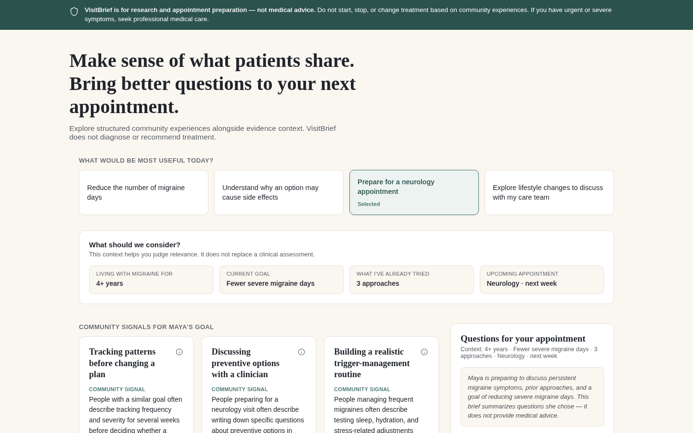
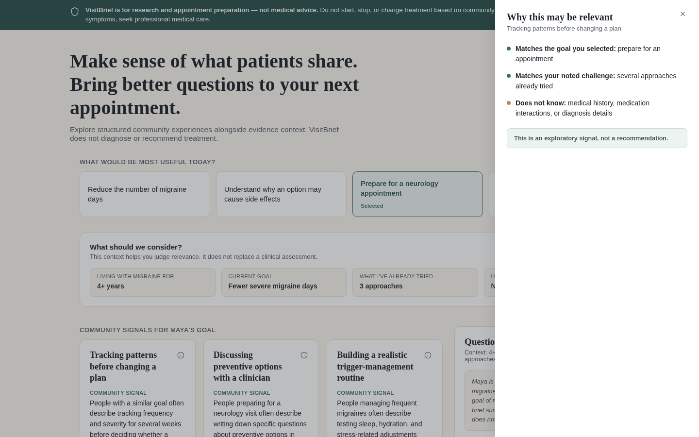
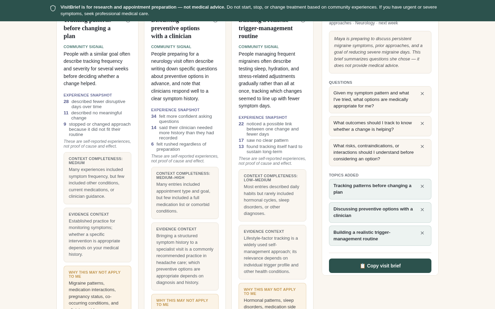

# VisitBrief — safety-first AI UX for patient communities

> Turn patient-community noise into better clinician conversations — without pretending to give medical advice.

**Live demo:** https://aidvalor.github.io/visitbrief/ _(GitHub Pages — enabled after publishing)_

| Overview | Why am I seeing this? | Visit brief |
|---|---|---|
|  |  |  |

A clickable, single-file prototype exploring how a consumer-health product could turn fragmented patient-community experience into a structured, safety-aware conversation with a clinician.

**File:** `index.html` — open directly in any modern browser. No build step, no install, no server.

## Product thesis

VisitBrief helps patients turn fragmented community experiences into structured, safety-aware questions and evidence signals to discuss with their clinician — not medical recommendations. The bet is that *organizing uncertainty transparently* is more valuable, and safer, than pretending an AI product can tell someone what's right for their body.

## User problem

Maya Chen, 34, has lived with chronic migraine for 4+ years, has tried several approaches, and has a neurology appointment next week. She's read hundreds of patient stories online and feels more overwhelmed than informed. Her job to be done: understand which patterns are worth raising with her clinician, see what context is missing, and walk into her appointment with sharper questions — without treating internet anecdotes as a substitute for clinical judgment.

## Main interaction loop

1. **Choose a goal** — what Maya wants out of today's session (defaults to "Prepare for a neurology appointment").
2. **Confirm context** — lightweight, editable, fictional fields that make relevance judgeable without functioning as a medical intake form.
3. **Scan community signal cards** — each card separates community-reported experience, evidence context, missing context, and explicit "why this may not apply to me" framing. No ratings, no efficacy claims.
4. **Inspect reasoning** — the "why am I seeing this" drawer exposes matching logic and, just as importantly, what the system does *not* know.
5. **Build a visit brief** — Maya curates questions and topics into a summary she can copy and bring to her clinician.
6. **Give feedback** — relevance and harm-reporting controls that visibly do not touch her medical care.

## Safety and quality principles

- No diagnosis, no treatment recommendation, no claim that anything "works."
- No language suggesting the user start, stop, or change a treatment.
- Every statistic is labeled self-reported and explicitly not causal proof.
- Every card names what context is missing and what could change the picture (medication interactions, comorbidities, pregnancy, clinician guidance).
- The safety strip is a persistent, designed product surface — not a buried legal footer — and stays visible while scrolling.
- Patient agency is structural, not cosmetic: the user selects the goal, edits context, chooses what enters the brief, and can flag harmful content.
- The generated visit-brief summary explicitly states it does not provide medical advice.

## What is fictional

Everything. Maya Chen, her history, the three community topics, every statistic (28/11/9, 34/14/6, 22/17/13), the "context completeness" ratings, and the evidence-context language are illustrative demo content only. No real patient data, medical records, clinical studies, or treatment claims are used or implied anywhere in this prototype.

## What I'd validate next with real patient research and clinical advisors

- Run contextual research sessions with chronic-migraine patients to test whether "context completeness" language actually helps them judge relevance, or reads as clinical jargon.
- Pressure-test the visit-brief format with practicing neurologists/headache specialists — does it save appointment time or create new friction?
- Work with a clinical-safety advisor to define a real taxonomy of "why this may not apply" risk factors per condition, and a review process for flagged content.
- Study how community signal should be sourced and moderated at scale (this prototype uses static mock data only).
- Test whether patients want quantified "experience snapshots" at all, versus qualitative pattern summaries, from a health-literacy and anxiety standpoint.
- Explore whether the tool should support conditions beyond migraine, and what changes structurally per condition (e.g., oncology vs. migraine have very different risk profiles).
- Evaluate legal/regulatory framing (wellness/education tool vs. anything resembling clinical decision support) with counsel before any real deployment.

## What I intentionally did not build in V1

- No accounts, login, or persistence — this is a single-session demo.
- No real community data ingestion, moderation pipeline, or content sourcing.
- No clinician-facing view or EHR integration.
- No personalization engine or ML — "why this may be relevant" logic is deliberately simple and rule-based so its reasoning is fully inspectable.
- No support for conditions other than migraine.
- No multi-appointment history or longitudinal tracking.
- No true legal/compliance review layer (explicitly out of scope for a prototype).

## 60-second walkthrough script

"This is VisitBrief, an independent prototype I built to explore safety-first AI UX. Meet Maya — she's lived with migraine for four years and has a neurology appointment next week.

Notice the safety strip up top — it's not a footer, it's core UI: this tool is for research and appointment prep, not medical advice.

Maya's goal is already set to 'prepare for a neurology appointment,' and her context — how long she's had migraine, what she's tried — is right here, editable, but clearly not a clinical intake.

Below, three community signal cards. Each separates what the community says, from evidence context, from what's still unknown — and each one tells Maya explicitly why it might *not* apply to her. No star ratings, no 'this works' claims.

If I click the info icon here, a drawer opens explaining exactly why this card was surfaced — matched to her goal, matched to her situation — and, critically, what the system doesn't know about her, like medication interactions or diagnosis details.

Maya adds a couple of topics to her visit brief on the right. It compiles into a short, honest summary and a set of concrete questions — she can copy it and bring it straight to her clinician.

And down here — she can mark something as not relevant, and the product tells her plainly: this improves relevance, it does not change her medical care.

That's the whole loop: community noise in, better clinical conversation out — with the patient in control the entire way."

---

_Personal project; not affiliated with or endorsed by any company._ All content is synthetic. License: MIT
